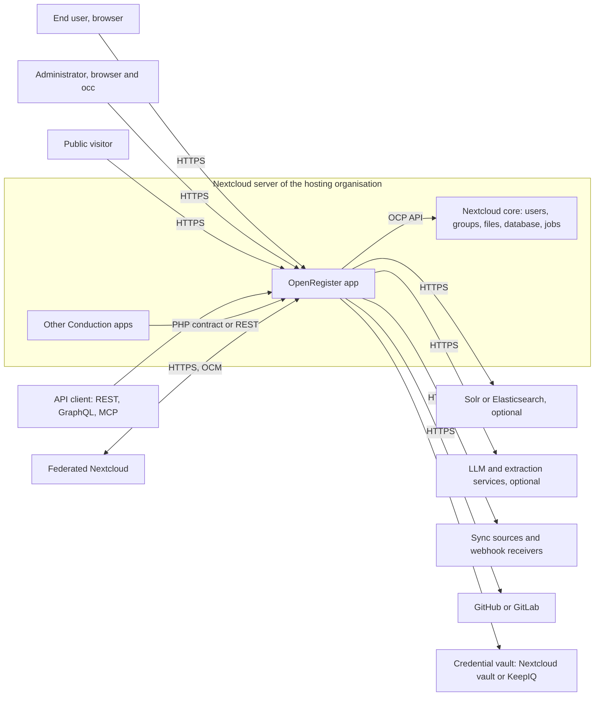
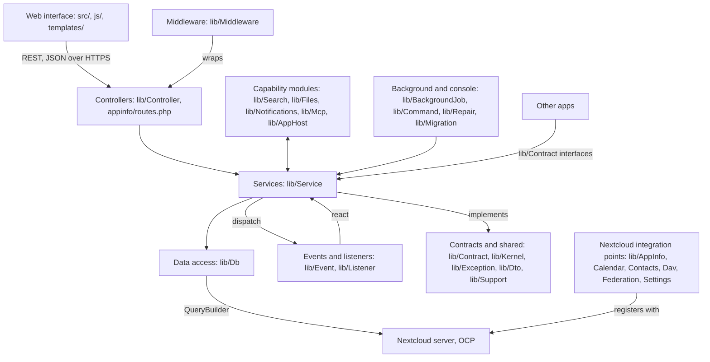

# Maintainability: high-level description

This page describes OpenRegister for a maintainability assessment, such as one by the Software Improvement Group (SIG). It covers the technologies, the system boundary, the components, what is out of scope and how we test. Every answer names the file or measurement it rests on. Measurements are from development at commit 30fbb6d5d676 (9 November 2026) unless a line says otherwise.

## General information

### Name of the system

OpenRegister (Nextcloud app id `openregister`), https://github.com/ConductionNL/openregister

*Sources: appinfo/info.xml*

### Version and snapshot

App version 2.1.35-unstable.20261106140000, snapshot of branch development at commit 30fbb6d5d676 (9 November 2026). The latest stable release is v2.1.0 (6 September 2026). Which branch SIG receives is still to be agreed: `main` is far behind `development`.

*Sources: appinfo/info.xml `<version>`; git tags; internal measurement, main 10,002 commits behind, 8 Nov 2026*

### In production since

The first tagged release is v0.1.2 (6 September 2024), published to the Nextcloud App Store. v1.0.0 followed on 8 May 2026 and v2.1.0 on 6 September 2026. The date of the first production customer is to be confirmed.

*Sources: git tags v0.1.2, v1.0.0, v2.1.0*

### Phase of the lifecycle

Evolution. OpenRegister is in production and we still add functionality at a high rate: 11,009 commits landed on development between 9 August and 9 November 2026.

*Sources: git log --since=2026-08-09 on development; openspec/changes/ (open change proposals)*

### How critical the system is

High (to be confirmed). OpenRegister is the data layer of the other Conduction apps, such as OpenCatalogi, Pipelinq and Dossiq. When it is down, those apps cannot read or write their data. A short outage is not catastrophic, because it runs per Nextcloud instance and each customer hosts its own.

*Sources: ARCHITECTURE.md (system boundary); appinfo/info.xml description*

## Technologies

### Back end

PHP 8.3 or later on the Nextcloud App Framework (public `OCP` API), Nextcloud 32 to 35.

Main libraries: opis/json-schema 2.3 (object validation), webonyx/graphql-php 15, symfony/workflow 6.4, twig 3.27 (sandboxed templates), guzzlehttp/guzzle 7, web-token/jwt-library 4.1, phpseclib 3, phpoffice/phpspreadsheet 5, smalot/pdfparser 2.9, elasticsearch/elasticsearch 9.5, theodo-group/llphant 1.0, minishlink/web-push 11, react/async 4.

*Sources: appinfo/info.xml `<dependencies>`; composer.json require*

### Front end

Vue 3.5 with TypeScript 5.8 and JavaScript, Pinia 3, vue-router 5, @nextcloud/vue 9.13 and our shared library @conduction/nextcloud-vue 2.175. Built with webpack through @nextcloud/webpack-vue-config 7 and Babel 7.

*Sources: package.json dependencies and devDependencies*

### Data storage

OpenRegister has no database of its own. It uses the Nextcloud database through the Nextcloud QueryBuilder (Doctrine DBAL): PostgreSQL 10 or later (with pgvector for vector search), MySQL 8.0 or later, MariaDB, or SQLite. Files attached to objects live in Nextcloud file storage. Apache Solr 9 and Elasticsearch 8 or 9 are optional search back ends. Caching uses the Nextcloud memory cache (APCu or Redis).

*Sources: appinfo/info.xml `<database>`; ARCHITECTURE.md; docker-compose.yml (pgvector/pgvector:pg16, solr:9-slim, elasticsearch:8.11.3)*

### Testing, analysis, build and deployment

- Testing: PHPUnit 10.5, Jest 29 with @vue/test-utils, Playwright 1.64, Newman (Postman collections).
- Static analysis: PHP_CodeSniffer 3.9, PHPMD 2.15, Psalm 5, PHPStan 2, ESLint 10, Stylelint 17, Spectral (OpenAPI lint), REUSE (licensing).
- CI: GitHub Actions (`.github/workflows/code-quality.yml`, which reuses ConductionNL/.github `quality.yml`) plus the Hydra gates (`conduction/hydra-gates`).
- Release: GitHub Actions builds the app archive for the Nextcloud App Store, with a CycloneDX SBOM per release.
- Development environment: Docker Compose (Nextcloud 34, PostgreSQL, optional Solr, Elasticsearch, Ollama, n8n).
- Specifications: OpenSpec (Markdown) in `openspec/`. Documentation: Docusaurus in `docs/`.

*Sources: composer.json require-dev; package.json devDependencies; .github/workflows/; SECURITY.md (SBOM); docker-compose.yml*

## The system

### What OpenRegister does

OpenRegister stores structured data for Nextcloud. Administrators define data models as JSON Schema and group them in registers. Users and other apps then create, read, update and delete objects that are validated against those schemas.

Main functional scenarios:
- An administrator defines a register and its schemas, or imports them as a configuration package.
- A user creates and edits objects in the web interface, with files attached and relations to other objects.
- Another app, such as OpenCatalogi, Pipelinq or Dossiq, stores its data in OpenRegister instead of in tables of its own.
- An external system reads or writes objects through the REST API, GraphQL or MCP (for AI assistants).
- Users search across registers with full-text search, filters and facets.
- Every change is recorded in an audit trail. Retention rules archive or delete objects when their term ends.
- Changes fire events, webhooks and notifications, and can start flows and business rules.
- Text is extracted from attached files and can be vectorised for semantic search.

*Sources: ARCHITECTURE.md; appinfo/info.xml description; docs/Features/*

### Where the system stops and who it talks to

OpenRegister runs inside a Nextcloud server as an app. The diagram shows it as a black box with the actors and systems around it.

- End users and administrators use the web interface in a browser. Administrators also use `occ` console commands.
- Public visitors read data that a schema makes public, or open an access link.
- API clients call the REST API under `/apps/openregister/api`, GraphQL and the MCP endpoint.
- Other Conduction apps call OpenRegister in the same PHP process through its published contract (`lib/Contract/`), or through the REST API.
- Nextcloud core provides users, groups, the database, file storage, background jobs and notifications through the `OCP` API.
- Optional outbound services: Solr or Elasticsearch, LLM and text extraction services, webhook receivers, external data sources, GitHub or GitLab for configuration packages, OAuth2 providers.
- Federated Nextcloud instances exchange shares over Open Cloud Mesh.

*Sources: ARCHITECTURE.md (system boundary); appinfo/routes.php; lib/Federation/; lib/Mcp/*

### How it was built, and by whom

Development started in August 2024 (first commit 24 August 2024) at Conduction B.V. The repository holds 19,071 commits on development.

- 2024: a team of about six Conduction developers (Ruben van der Linde, Thijn, Robert Zondervan, Wilco Louwerse, Remko Huisman, Barry Brands), 464 commits.
- 2025: Ruben van der Linde wrote two thirds of the 3,366 commits, with Robert Zondervan, Barry Brands, Remko Huisman, Thijn and Wilco Louwerse.
- 2026: 15,235 commits so far. Ruben van der Linde leads, with Wilco Louwerse and Robert Zondervan. Since 2026 most changes are written by AI coding agents (Claude Code) that developers direct and review. At least 48% of the commits since 9 August 2026 carry an explicit AI attribution.

The FTE figures, past and current, are to be confirmed by Conduction.

*Sources: git log on development, authors per year (measured 9 Nov 2026); Assisted-by trailers since 2026-08-09: 5,290 of 11,009 commits*

## Scope for maintainability

### Components and how they connect

The diagram shows the components and how they connect. The browser reaches the controllers over REST with JSON. All other arrows are PHP code dependencies (calls, type hints, inheritance). Other apps call OpenRegister through the interfaces in `lib/Contract/`.

The table maps every directory under `lib/` and every production directory at the root to a component. `sigrid.yaml` declares the same split: each directory under `lib/` is a component (`component_base_dirs: ["lib", ""]`).

ARCHITECTURE.md also describes a functional grouping (objects, schemas and registers, access control, retention and more). Those functional components cut across `lib/Service/` and `lib/Db/`, so they do not map to directories one to one. Decoupling them behind interfaces is work in progress (ADR-119, being decided in hydra#774).

| Name | Source code paths | What it does |
|---|---|---|
| Web interface | src/, templates/, js/ (3 hand-written scripts), css/, img/ | Vue 3 single-page front end, the PHP templates that mount it, and static scripts for web push and the flow operator. |
| App manifest and routes | appinfo/ | App metadata (info.xml) and the route table (routes.php) that maps URLs to controllers. |
| Controllers | lib/Controller/ | HTTP API and page controllers. They check the caller's rights and hand over to services. |
| Middleware | lib/Middleware/ | Request pipeline: rate limits, tenant quotas, CORS for public endpoints, request validation, audit of protected field reads. |
| Services (business logic) | lib/Service/ | All capabilities: objects, schemas and registers, RBAC, configuration and import, flows and rules, retention, credentials. Holds 54% of the PHP code. |
| Data access | lib/Db/ | Entities and mappers, including MagicMapper, which stores objects in one table per schema. |
| Search | lib/Search/ | Search, facets, aggregations, GraphQL, Solr and Elasticsearch back ends, vectorisation. |
| Files | lib/Files/ | File storage for objects, text extraction and chunking. |
| Notifications | lib/Notifications/, lib/Notification/, lib/Push/, lib/Activity/ | Notifications, webhooks, web push and the Nextcloud activity stream. |
| MCP | lib/Mcp/ | Model Context Protocol server and tool registry for AI assistants. |
| App host | lib/AppHost/ | Runtime that serves manifest-driven apps built on OpenRegister. |
| Events and listeners | lib/Event/, lib/Listener/ | Typed events fired on changes, and the listeners that react to them. |
| Background and console | lib/BackgroundJob/, lib/Command/, lib/BulkAction/ | Cron jobs (extraction, retention sweeps, audit sealing), occ commands, bulk actions. |
| Install and upgrade | lib/Migration/, lib/Repair/ | Database migrations (frozen once released) and repair steps. |
| Contracts and shared code | lib/Contract/, lib/Kernel/, lib/Exception/, lib/Dto/, lib/Support/, lib/Formats/, lib/Twig/, lib/Lifecycle/ | Published interfaces for other apps (ADR-084), internal interfaces between components, exceptions, value objects and helpers. |
| Nextcloud integration points | lib/AppInfo/, lib/Calendar/, lib/Contacts/, lib/Dav/, lib/ContextChat/, lib/Federation/, lib/Reference/, lib/Dashboard/, lib/Sections/, lib/Settings/, lib/Capabilities/, lib/WorkflowEngine/ | Bootstrap and the providers Nextcloud loads: calendar, contacts, DAV, Context Chat, federation, link previews, dashboard widgets, settings pages, capabilities, workflow operations. lib/Settings/ also holds shipped register definitions (JSON). |
| Shipped vocabularies | lib/Resources/, lib/Service/Flow/Bpmn/schema/ | Third-party specifications shipped unchanged (schema.org, TOOI, MDTO, BPMN, GGM). See out of scope. |

*Sources: ARCHITECTURE.md; sigrid.yaml; hydra openspec/architecture/adr-084-openregister-published-contract.md; hydra#774 (draft ADR-119); internal measurement, lib/Service is 212,720 of 391,667 PHP LOC (54%), commit 4eccbfbc, 8 Nov 2026*

### Code we do not maintain as production code

Everything under `lib/`, `src/`, `appinfo/` and `templates/` is production code that we maintain, apart from the rows below. `sigrid.yaml` excludes the generated and tooling paths on top of Sigrid's default excludes, and ARCHITECTURE.md gives the role of each directory.

| Path | Why it is out of scope |
|---|---|
| lib/Migration/ | Database migrations. Production code, but each file is frozen once released. |
| lib/Resources/, lib/Service/Flow/Bpmn/schema/ | Third-party vocabularies and specifications shipped unchanged (schema.org, TOOI, MDTO, BPMN, GGM). REUSE.toml names their owners. |
| l10n/*.js | Generated from l10n/*.json, the translation catalogues. No logic. |
| js/ (except the three hand-written scripts) | Webpack build output. Ignored by git. |
| vendor/, node_modules/, vendor-bin/ | Third-party packages installed by Composer and npm. Not in the repository; vendor-bin/ only holds manifests for isolated tools. |
| patches/ | Patches applied to third-party Composer packages at install time. |
| scripts/, tools/, openspec/changes/**/ scripts | Developer tooling: translation, quality, release and one-off change scripts. Not shipped. |
| openspec/ | Specifications and change proposals (Markdown). |
| docs/ | Documentation site (Docusaurus). |
| docker/, docker-compose*.yml, openregister-compose.yaml, exapps/, n8n-templates/, n8n-mcp/, data/ | Local development and demo environments and example workflow templates. |
| .github/, .claude/, root configuration files (eslint.config.mjs, phpstan-bootstrap.php, webpack.config.js, jest and playwright configs) | CI configuration, AI developer tooling and build or analysis configuration. |
| tests/ and src/**/*.spec.js, *.spec.ts | Test code. See the next question. |

*Sources: ARCHITECTURE.md (directory roles); sigrid.yaml exclude; REUSE.toml*

### How we test, and where the test code is

We run unit, integration, regression and end-to-end tests. All PHP test code lives in `tests/`. Front-end unit tests sit next to the code they test, with the suffix `.spec.js` or `.spec.ts`. Nothing under `lib/` or `src/` without that suffix is test code. CI runs the unit tests, Newman and Playwright on every pull request, so the full set doubles as the regression suite. Our test code ratio is about 159% (test lines against production lines, measured 8 November 2026).

| Path | What it tests |
|---|---|
| tests/Unit/ | PHPUnit unit tests, about 32,700 test methods. Runs in CI on every pull request. PHP statement coverage 79.64% (CI clover report, 8 November 2026). |
| tests/Unit/Architecture/ | Architecture tests, for example that contracts stay leaves of the dependency graph. |
| tests/Integration/, tests/integration/ | Integration tests against a running Nextcloud: PHPUnit, and Postman collections that CI runs with Newman (41 collections). |
| tests/Service/, tests/Db/, tests/Api/, tests/Contract/ | Service, database, API and contract tests. Not all of them run in the default CI suite yet. |
| tests/e2e/ | End-to-end tests with Playwright (144 spec files), run in CI against a Nextcloud instance. |
| src/**/*.spec.js, src/**/*.spec.ts | Front-end unit tests with Jest and @vue/test-utils (370 spec files), next to the code they test. |
| tests/Fixtures/, tests/fixtures/, tests/stubs/, tests/__mocks__/, tests/Data/ | Test data, stubs and mocks. |
| tests/perf/, tests/performance/, tests/manual/, scripts at tests/ root | Performance and manual test scripts, run by hand. |

*Sources: ARCHITECTURE.md (test code); phpunit.xml; package.json scripts; .github/workflows/code-quality.yml (enable-phpunit, enable-newman, enable-playwright); internal measurement, coverage 79.64%, ratio 159.4%; internal measurement, 32,725 test methods*

## Other remarks

### Notes for the assessor

- ARCHITECTURE.md in the repository root is written for assessors. It names the components, their boundaries and the role of each directory.
- `sigrid.yaml` pins the maintainability model to 2026, declares the components and excludes generated files and tooling.
- OpenRegister is large: about 392,000 lines of PHP outside migrations and about 115,000 lines of front-end code. We are reducing coupling between components and splitting long parameter lists. Several architecture decisions for this are being decided (hydra#770 to #778).
- Most of the code since 2026 was written by AI coding agents under developer direction. Every change goes through the same CI gates as human code.
- Please tell us which branch you analyse. `development` is current, `main` lags far behind.

*Sources: ARCHITECTURE.md; sigrid.yaml; internal measurement, 391,667 PHP LOC at 4eccbfbc; hydra draft PRs #770-#778*

## Related

See also [the security description](./hld-security.md) and [ARCHITECTURE.md](https://github.com/ConductionNL/openregister/blob/development/ARCHITECTURE.md).
