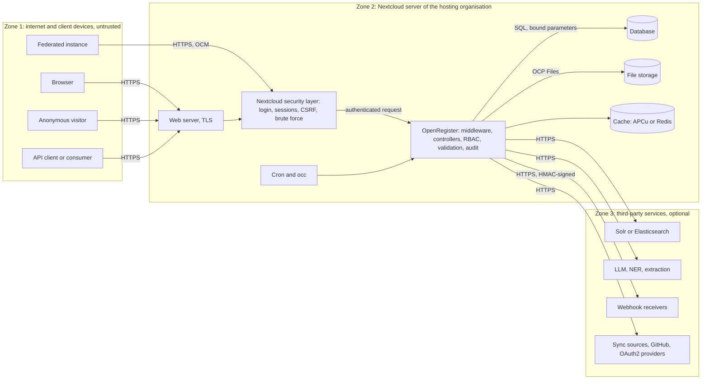

# Security: high-level description

This page describes the security design of OpenRegister for a security assessment, such as one by the Software Improvement Group (SIG). It covers the data flow, the connections in and out, the data stores and the controls for authentication, authorization, cryptography, input handling, configuration, logging and dependencies. Every answer names the file it rests on. Report a vulnerability as described in [SECURITY.md](https://github.com/ConductionNL/openregister/blob/development/SECURITY.md), never in a public issue.

## General information

### Name of the system

OpenRegister (Nextcloud app id `openregister`)

*Sources: appinfo/info.xml*

### The programs that make up OpenRegister

- Program 1: OpenRegister back end. PHP 8.3 Nextcloud app on the App Framework: REST/JSON, GraphQL and MCP web service, runs inside the Nextcloud web server (`lib/`, `appinfo/`).
- Program 2: OpenRegister front end. Vue 3 single-page application in TypeScript and JavaScript, served by Nextcloud (`src/`, `templates/`).
- Program 3: static browser scripts. Web push client, its service worker and the flow operator (`js/`).
- Program 4: background jobs and console commands. PHP, run by Nextcloud cron and `occ` (`lib/BackgroundJob/`, `lib/Command/`).
- Program 5: database migrations and repair steps. PHP, run on install and upgrade (`lib/Migration/`, `lib/Repair/`).
- Program 6: development, test and release tooling. Shell, Node and Python scripts, not shipped (`scripts/`, `tools/`, `docker/`).

*Sources: ARCHITECTURE.md (directory roles)*

## Technologies

### Main languages

PHP 8.3, TypeScript and JavaScript (Vue 3 single-file components)

*Sources: composer.json; package.json*

### Other languages

SQL through the Nextcloud QueryBuilder, Twig templates, JSON Schema, shell and Python for tooling only

*Sources: lib/Db/; composer.json (twig/twig); scripts/*

### Databases

The Nextcloud database: PostgreSQL 10 or later, MySQL 8.0 or later, MariaDB or SQLite. Optional search indexes in Apache Solr or Elasticsearch.

*Sources: appinfo/info.xml `<database>`*

### User interface

Vue 3.5 with Pinia, vue-router, @nextcloud/vue 9 and @conduction/nextcloud-vue, inside the Nextcloud web interface

*Sources: package.json*

### Security frameworks and libraries

- Nextcloud App Framework security middleware: authentication, CSRF tokens, admin and sub-admin checks, brute-force protection and rate-limit attributes.
- Nextcloud `ICrypto`, `ICredentialsManager`, `ISecureRandom`, `IHasher` and the Content Security Policy manager.
- web-token/jwt-library 4.1 and phpseclib 3 for JWT and RSA signature checks.
- libsodium (Ed25519) for signing configuration bundles.
- opis/json-schema 2.3 for input validation, Twig sandbox for user-authored templates.
- DOMPurify 3.4 for the one place that renders HTML in the front end.

*Sources: composer.json; package.json; lib/Service/Consumer/JwtValidator.php; lib/Service/Config/BundleSigner.php; lib/Service/Object/SaveObject/ComputedFieldHandler.php*

## System and high-level design

### What OpenRegister does, for whom and with which data

OpenRegister is the data layer of Conduction's Nextcloud apps. Organisations, mostly Dutch municipalities and other public bodies, define registers and JSON Schemas and store objects in them. Their staff work with the data in the browser; other apps and external systems use the API.

Users: staff of the hosting organisation, administrators who configure registers, schemas and access, and external systems with their own credentials. Where an organisation makes data public, anonymous visitors can read it.

Data: what the organisation models, for example cases, contacts, products or publications. That can include personal data such as names, addresses and citizen service numbers (BSN). Files attached to objects, an audit trail of every change and configuration such as connection settings are stored too.

Usage scenarios: create and edit objects, search with facets, import and export, share objects with people or by link, retention and archiving, events and webhooks to other systems, and AI assistants working through MCP within the user's rights.

*Sources: appinfo/info.xml; ARCHITECTURE.md; lib/Service/FieldEncryptionHandler.php (BSN, medical, financial data as use case)*

### Data flow and trust boundaries

The diagram shows the users and systems, the processes and data stores, and the trust boundaries.

- Zone 1, untrusted: browsers, anonymous visitors, API clients and federated instances. They reach the server over HTTPS only.
- Zone 2, the hosting organisation's Nextcloud server. TLS ends at its web server. Nextcloud authenticates the request before OpenRegister runs. OpenRegister then checks rights, validates input and writes the audit trail. It stores data in the Nextcloud database (SQL with bound parameters), in Nextcloud file storage and in the memory cache.
- Zone 3, third-party services. OpenRegister calls them over HTTPS, and only when an administrator has configured them: Solr or Elasticsearch, LLM and extraction services, webhook receivers, sync sources, GitHub and OAuth2 providers.

File formats on the flows: JSON for the APIs and webhooks, JSON-RPC for MCP, multipart or base64 for file uploads, CSV, Excel and JSON for import and export.

*Sources: ARCHITECTURE.md (system boundary, request flow); appinfo/routes.php; lib/Service/Outbound/OutboundHttpClient.php*

### Connections into OpenRegister

Nextcloud authenticates every request before OpenRegister runs, except on endpoints marked public. All public controller methods carry a rate-limit or brute-force attribute (77 methods, checked 9 November 2026). Rows that a schema does not expose stay behind the RBAC checks described under authorization.

| Name | Protocol | Authentication |
|---|---|---|
| Web interface (Vue SPA) | HTTPS, TLS by the host's web server | Nextcloud login: password with optional second factor, or single sign-on through a Nextcloud SSO app (OIDC or SAML). Session cookie plus CSRF request token. |
| REST API /apps/openregister/api | HTTPS, JSON | Nextcloud session, HTTP Basic with an app password, or OAuth2 bearer token issued by Nextcloud. |
| API endpoints for configured consumers | HTTPS, JSON | Per consumer: JWT signed with HMAC, RSA or RSA-PSS, API key, Basic or OAuth2 bearer. |
| GraphQL /api/graphql | HTTPS, JSON | Same as the REST API. Anonymous reads only reach public data and are rate limited. |
| MCP endpoint /api/mcp | HTTPS, JSON-RPC | Nextcloud user authentication. Tools run with that user's rights. |
| Public read and submit endpoints | HTTPS, JSON | None, by design, for data a schema makes public. Rate limited per IP. |
| Access links and share links | HTTPS | Random link token, optional password, expiry date. |
| Calendar feeds, case and portal tokens | HTTPS | Random token per feed or case, revocable, optionally with an expiry. The feed is generated with the rights of the user who created it. |
| WebDAV and CalDAV write-back | HTTPS, WebDAV | Nextcloud DAV authentication. |
| Federation (Open Cloud Mesh) | HTTPS, OCM | Nextcloud federation between trusted servers. |
| OAuth2 connect callback | HTTPS | Signed, single-use state with PKCE, bound to the flow that started it. |
| occ commands and cron | Local process | Shell access to the server. |

*Sources: appinfo/routes.php (1,051 routes); lib/Service/AuthorizationService.php; lib/Mcp/Controller/McpServerController.php; lib/Service/Sharing/AccessLinkSecrets.php; docblock scan of #[PublicPage] methods, 9 Nov 2026; hydra ADR-082 (public endpoint throttling)*

### Connections OpenRegister makes

Every outbound HTTP call goes through one client, `OutboundHttpClient`, built on Nextcloud's `IClientService`. It applies the administrator's proxy settings, and Nextcloud's client refuses local and private addresses unless a call explicitly allows them.

| Name | Protocol | Authentication |
|---|---|---|
| Nextcloud core | In-process PHP (OCP API) | n/a |
| Nextcloud database | SQL via Doctrine DBAL; TLS as configured by the host | Database credentials in Nextcloud config.php |
| Apache Solr, Elasticsearch (optional) | HTTPS | Basic or API key, set by an administrator |
| LLM providers: OpenAI, Fireworks, Ollama (optional) | HTTPS | API key, set by an administrator |
| Text extraction and anonymisation: Presidio, Dolphin (optional) | HTTPS or local network | Endpoint and key set by an administrator |
| Webhook receivers | HTTPS, JSON | HMAC-SHA256 signature header per webhook |
| External data sources (sync) | HTTPS, REST | Per source: Basic, API key, OAuth2 or JWT; secrets encrypted |
| GitHub and GitLab (configuration packages) | HTTPS, REST | Personal access token, set by an administrator |
| OAuth2 providers (credential broker) | HTTPS, OAuth2 | Client id and secret; tokens kept in the credential vault |
| KeepIQ credential vault (optional) | In-process | Nextcloud user context |
| Federated Nextcloud servers | HTTPS, OCM | Nextcloud federation |
| Web push services | HTTPS, Web Push | VAPID keys |

*Sources: lib/Service/Outbound/OutboundHttpClient.php; lib/Service/WebhookRequestOptions.php (hash_hmac sha256); lib/Service/Credential/; lib/Service/Sync/RestApiSourceFetcher.php*

### Where data is stored

OpenRegister has no data store of its own beyond these. Encryption at rest of the database and file storage is the hosting organisation's choice. OpenRegister adds encryption for the most sensitive values on top.

| Name | Type | Encryption at rest | Sensitive data |
|---|---|---|---|
| Nextcloud database (objects, schemas, registers, audit trail, settings) | PostgreSQL, MySQL, MariaDB or SQLite; TLS as configured by the host | Disk encryption by the host. Opt-in per property: fields marked x-openregister-encrypted are encrypted with ICrypto | yes |
| Nextcloud file storage (files attached to objects) | Nextcloud storage back end | Nextcloud server-side encryption when the host enables it | yes |
| Credential vault (connection secrets, OAuth2 tokens) | Nextcloud ICredentialsManager or KeepIQ | yes, encrypted with the instance secret | yes |
| Search indexes (optional) | Apache Solr, Elasticsearch | As configured by the host | yes, copies of object data |
| Memory cache | APCu or Redis | no, volatile | possibly, short-lived |
| Audit sink file (optional) | Structured log file in Nextcloud data directory | As configured by the host | yes, audit metadata |

*Sources: lib/Service/FieldEncryptionHandler.php; lib/Service/Credential/NextcloudVaultCredentialStore.php; lib/Service/Audit/AuditSink.php*

## Security controls

### Authentication and sessions

OpenRegister does not run its own login. Nextcloud authenticates users with a password and optional second factor, or through single sign-on (OIDC or SAML apps). Nextcloud issues the session cookie, checks it on every request, sends a CSRF request token with every form and front-end call (`@nextcloud/axios`), and ends sessions on logout or expiry.

API clients authenticate with Nextcloud app passwords over HTTP Basic, or with an OAuth2 bearer token issued by the Nextcloud OAuth2 app. A token is only accepted when the request itself carried it, not when a session cookie came along.

For external systems an administrator can configure consumers. `AuthorizationService` then accepts a JWT, an API key, Basic or OAuth2 per consumer. JWTs are verified with HMAC, RSA or RSA-PSS. The algorithm comes from the consumer's stored configuration, never from the token header. The consumer maps to a Nextcloud user, so its rights are that user's rights.

Failed attempts on protected endpoints are counted per identity and IP address, and blocked after repeated failures (`RateLimitMiddleware`, on top of Nextcloud's own brute-force protection).

Links that work without an account (access links, calendar feeds, case tokens) use random tokens from `ISecureRandom` and can be revoked. Access links carry an expiry and can have a password, stored hashed with `IHasher`. A calendar feed is generated with the rights of the user who created it, so the token grants nothing that user could not read.

*Sources: hydra ADR-005 (Nextcloud auth only); lib/Service/AuthorizationService.php; lib/Service/Consumer/JwtValidator.php; lib/Middleware/RateLimitMiddleware.php; lib/Service/Sharing/AccessLinkSecrets.php; lib/Service/Calendar/CalendarFeedTokenService.php*

### Authorization

OpenRegister combines RBAC based on Nextcloud groups with attribute rules and organisation-based multi-tenancy. The server checks every rule. The front end only hides what the server would refuse anyway.

- Schema and register level: a schema's `authorization` block lists which groups may create, read, update and delete, plus actions the schema declares itself. Once a block is present, every action it does not name is refused.
- Conditional rules: an entry can carry a `match` on object fields, for example a confidentiality level or the caller's organisation. The rules are applied in SQL on lists and in PHP on single objects.
- Object level: owners and holders of the `grant_manage` right can make an object private and grant or revoke access per user or group.
- Property level: rules per property hide or protect single fields. Reads of protected fields are recorded in the audit trail.
- Multi-tenancy: data belongs to an organisation. Users see the data of the organisations they belong to.
- Administrators (`IGroupManager::isAdmin()`, checked on the server) manage configuration.
- Object reads, relation checks and list queries all resolve through one evaluator (`PermissionHandler`), so the verdict in PHP and in SQL is the same.
- API consumers and AI assistants act as a Nextcloud user. Their tokens can narrow that user's rights, never widen them.

Main code: `lib/Service/Object/PermissionHandler.php`, `lib/Service/Rbac/`, `lib/Db/MultiTenancyTrait.php` and the RBAC filter in `lib/Db/MagicMapper.php`.

*Sources: docs/Features/access-control.md; docs/Features/property-authorization.md; docs/Features/object-sharing.md; docs/Features/multi-tenancy.md; lib/Service/Rbac/; hydra ADR-005, ADR-023 (action authorization); lib/Service/Rbac/TokenGrantNarrower.php*

### Cryptography

OpenRegister reuses Nextcloud's crypto primitives and well-known libraries. It implements no algorithm of its own. Internal connections to the database and cache are protected by the host's configuration.

| Function | Technique or algorithm | Version or cipher suite |
|---|---|---|
| Transport security | TLS, terminated by the host's web server | As configured by the host; we recommend TLS 1.2 or later |
| Encryption of secrets and flagged fields at rest | Nextcloud ICrypto: AES-256-CBC with HMAC-SHA512 (encrypt-then-MAC), keys derived with HKDF-SHA512 from the instance secret | ciphertext format version 3, Nextcloud 32 to 35 |
| Credential vault | Nextcloud ICredentialsManager (ICrypto) | as above |
| Verify consumer JWTs | HMAC-SHA2 (HS256/384/512), RSA PKCS#1 v1.5 (RS256/384/512), RSA-PSS (PS256/384/512) | web-token/jwt-library 4.1, phpseclib 3 |
| Sign webhook payloads | HMAC-SHA256 | PHP hash_hmac |
| Sign and verify configuration bundles | Ed25519 | libsodium |
| Audit trail integrity | SHA-256 hash chain over canonical JSON of each entry | PHP hash |
| Passwords on access links | Nextcloud IHasher | Argon2id or bcrypt, per Nextcloud |
| Random tokens (links, feeds, OAuth2 state) | Nextcloud ISecureRandom | CSPRNG |
| User passwords | Handled by Nextcloud, not by OpenRegister | n/a |

*Sources: lib/Service/FieldEncryptionHandler.php; lib/Service/Consumer/JwtValidator.php; lib/Service/WebhookRequestOptions.php; lib/Service/Config/BundleSigner.php; lib/Service/AuditHashService.php; lib/Service/Sharing/AccessLinkSecrets.php*

### Handling untrusted input

- Object data is validated against its JSON Schema (opis/json-schema) before it is stored. Requests can also be validated against the OpenAPI description (`OasValidationMiddleware`).
- Database access uses the Nextcloud QueryBuilder with named parameters (about 1,200 call sites). Table and column names that come from schema definitions are quoted and escaped for the database platform, and checked before a table is changed.
- Route parameters are constrained with requirements in `appinfo/routes.php`.
- Templates that users author (computed fields, mappings) render in a Twig sandbox with an allow-list of tags, filters and functions.
- Uploads are checked for executable content by extension and by magic bytes, also after base64 decoding (`ExecutableContentDetector`). Nextcloud's antivirus app can scan files on top.
- Deserialisation of cached data is limited to known classes.
- The front end uses Vue templates, which escape output. The one place that renders HTML sanitises it with DOMPurify first.
- Outbound calls go through one client that applies Nextcloud's protection against requests to local addresses.
- CI runs static analysis (Psalm, PHPStan) and the Hydra security gates on every pull request.

*Sources: lib/Service/Object/ValidateObject.php (opis); lib/Middleware/OasValidationMiddleware.php; lib/Db/MagicMapper.php quoteIdentifier(); lib/Service/SharedSchema/SchemaTableMigrator.php; lib/Service/MappingService.php createTwig(); lib/Service/File/ExecutableContentDetector.php; lib/Service/Configuration/CacheHandler.php; src/components/shared/SettingsSection.vue*

### Security configuration and secrets

Response headers: Nextcloud sets the security headers for every response, including Content-Security-Policy with nonces, X-Frame-Options, X-Content-Type-Options, Referrer-Policy and X-Robots-Tag. HSTS is set by the host's web server. OpenRegister adds to the default policy only what a feature needs: `worker-src 'self'` for the web push service worker and GitHub avatar images. Responses from public endpoints get CORS headers without credentials (`PublicApiCorsMiddleware`).

Secrets: credentials for external sources are encrypted with `ICrypto`. OAuth2 tokens and broker credentials live in the Nextcloud credential vault or KeepIQ, and objects store only a reference (hydra ADR-064). Tenant log lines go through `TenantLogRedactor`, which drops a line it cannot prove free of secrets. Database credentials and the instance secret live in Nextcloud's `config.php`, which the host protects.

Configuration files: OpenRegister ships no production configuration. Each organisation runs its own Nextcloud; its `config.php` and OpenRegister's app settings (stored in the database through `IAppConfig`) are the production configuration. The Docker Compose files in the repository are for development and demos and differ from production: they use default passwords, plain HTTP and debug settings.

*Sources: lib/AppInfo/Application.php (CSP additions); lib/Middleware/PublicApiCorsMiddleware.php; lib/Service/TenantLogRedactor.php; hydra ADR-064 (credential custody); docker-compose.yml*

### Security logging

What we log:
- Every create, update and delete of an object in the audit trail, with user, session, request id, IP address, organisation and processing purpose. Reads of protected fields are logged as well.
- Changes to access: grants and revocations, ownership handovers, changes to authorization settings on schemas and registers, and changes to security settings.
- Failed authentication on protected endpoints and rate-limit blocks, through Nextcloud's logger. Nextcloud and its audit app log logins and logouts.

Where: the audit trail is a database table (`openregister_audit_trails`). Optionally every entry is also written to a structured file that the organisation's log platform or SIEM reads (`AuditSink`). Technical events go to the Nextcloud log (file or syslog, set by the host).

Sensitive data: tenant log lines name the organisation and a pseudonymous actor reference, and carry no secrets (`TenantLogRedactor`). Audit history shown to readers is redacted to what they may see.

Tampering: a background job seals audit entries into a SHA-256 hash chain. Changing or removing an entry breaks the chain, and the integrity check reports it. Shipping entries to an external log platform keeps a copy outside the application. Retention periods per entry follow the retention rules.

*Sources: lib/Db/AuditTrail.php; lib/Service/AuditHashService.php; lib/BackgroundJob/AuditSealJob.php; lib/Service/Audit/AuditSink.php; lib/Service/Rbac/GrantChangeAuditor.php; lib/Service/Rbac/SettingsChangeAuditor.php; lib/Service/AuthorizationAuditService.php; lib/Middleware/RevealAuditMiddleware.php; lib/Service/TenantLogRedactor.php; docs/features/versioning-and-audit.md*

### Third-party dependencies

All third-party code comes in through package managers: Composer for PHP and npm for JavaScript, with committed lock files. Composer uses Packagist plus two pinned GitHub sources (LLPhant, and our fork of the PDF signing library sapp). npm uses the public registry. Three small patches to Composer packages are applied at install time and kept in `patches/`.

- Dependabot proposes updates for npm and Composer every week on `development`. Majors we cannot take yet are listed with the reason in `.github/dependabot.yml`.
- Cooldowns: npm refuses releases younger than two days (`.npmrc`), Dependabot waits one day for Composer (hydra ADR-093).
- `roave/security-advisories` blocks installing PHP packages with known advisories. CI runs `composer audit` as a gate on every pull request, and `npm audit` when a release is built.
- Every release ships a CycloneDX SBOM. Grype scans it, and a critical vulnerability stops the release.
- CI installs from the lock files (`npm ci`, `composer install`, hydra ADR-090) and runs REUSE for licences.

*Sources: composer.json (repositories, roave/security-advisories); .github/dependabot.yml; .npmrc; patches/; SECURITY.md (SBOM, Grype); hydra ADR-090, ADR-093; hydra-gate-composer-audit*

## Other remarks

### Notes for the assessor

- SECURITY.md describes how to report a vulnerability (security@conduction.nl) and the response times. `/.well-known/security.txt` is served by the app.
- Security rules for all Conduction apps are recorded in hydra ADR-005 (security), ADR-054 (public surface hardening), ADR-064 (credential custody) and ADR-082 (public endpoint throttling). Hydra's mechanical gates check several of them on every pull request, for example per-object authorization, route authorization and unsafe auth fallbacks.
- We have no external penetration test report to share at this time.

*Sources: SECURITY.md; lib/Controller/WellKnownController.php; hydra openspec/architecture/; hydra-gates skills list*

## Related

See also [the maintainability description](./hld-maintainability.md).
