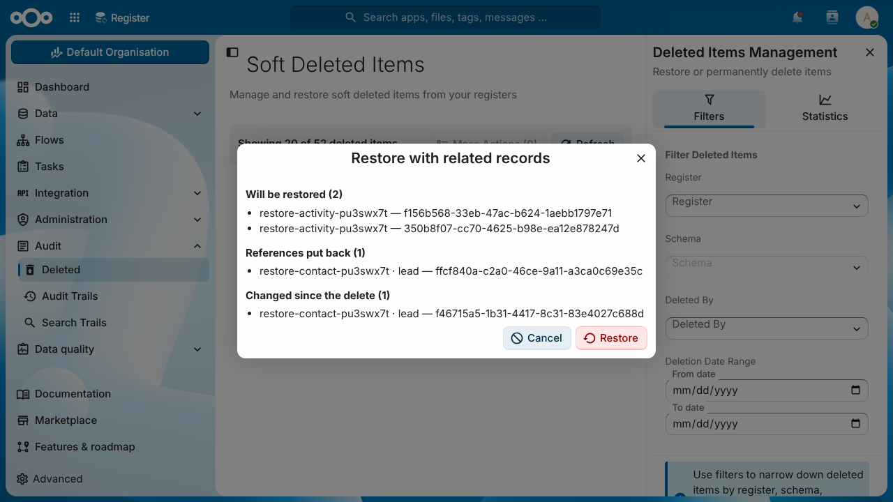

# Restoring a record with its related records

Deleting a record can reach further than the record itself. A property that
references it with `onDelete: CASCADE` deletes the referring records with it,
and one with `SET_NULL` or `SET_DEFAULT` empties or resets the reference. A
plain restore brings back the one record. **Restore with related records**
also undoes what its delete did to the others, as far as that is still true.

## Specs

- [deletion-audit-trail](../../openspec/changes/records-restore-with-cascade/specs/deletion-audit-trail/spec.md) — change `records-restore-with-cascade`

## What the delete records

Every record a delete takes with it, and every reference it empties, is
written to the audit trail with the deleted record as its trigger. The
restore reads that evidence; it never guesses from the current data. A delete
from before this was recorded says so in the preview ("This delete did not
record its related records"), and only the record itself is restored.

## The preview

On **Audit → Deleted**, open a row's menu and choose **Restore with related
records**. Before anything is written, the dialog lists what the restore will
do, by class:

| Group | Meaning |
| --- | --- |
| Will be restored | Deleted together with this record, and still deleted and inside its recovery window. |
| References put back | A reference the delete emptied, which still holds what the delete wrote. |
| Changed since the delete | A reference someone set to another value after the delete. **Left alone.** |
| Destroyed or past the recovery window | Gone for good; cannot come back. |
| Already restored | Restored or recreated since, or deleted again later by another act. |

A caller who may not update one of the related records sees "Related records
you may not restore", and the restore changes nothing: it is all or none.

## Two rules

- **A restore never writes over a field someone changed after the delete.**
  In the example above, the second contact was pointed at another lead after
  the delete; it keeps that lead.
- **A caller without `update` on one related record changes nothing.** The
  whole restore runs in one transaction, and a refusal on one record rolls back
  the rest.

## API

| Call | What it does |
| --- | --- |
| `GET /api/deleted/{id}/restore-preview` | The plan: `cascadeKnown`, the uuids per class (`restore`, `relink`, `changed`, `gone`, `already`) and `forbidden.count`. |
| `POST /api/deleted/{id}/restore` | Restores the record with its related records. Send `{"cascade": false}` to restore the record alone. 403 when a related record may not be restored, 409 over the cap. |

The plan is capped at 5,000 related records; a larger delete is refused with
409 rather than restored in part.

## Proof

`tests/e2e/ci/restore-with-cascade.spec.ts` deletes a lead with two cascading
activities and two contacts whose reference is set to null, points one contact
at another lead, restores from the Deleted page and reads every record back
from the object API.
