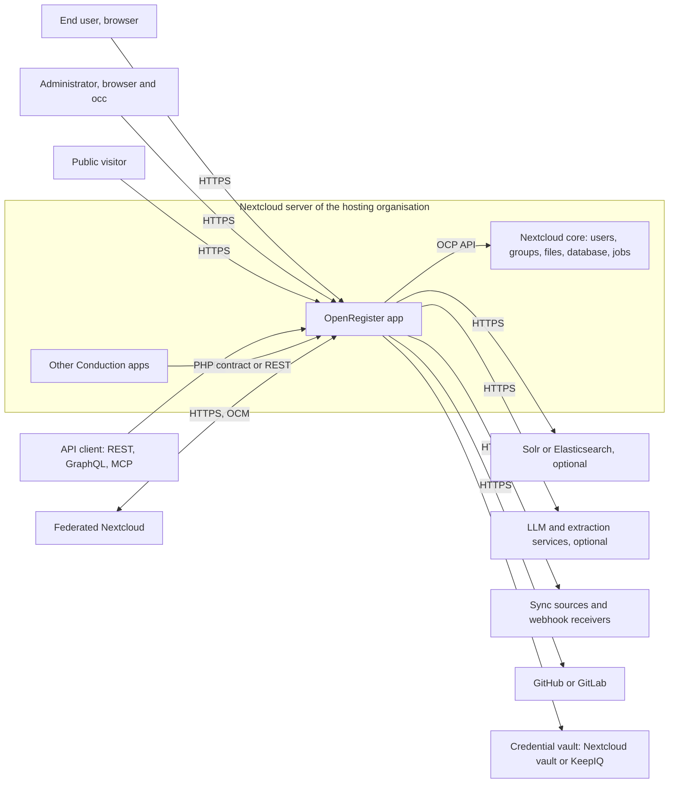
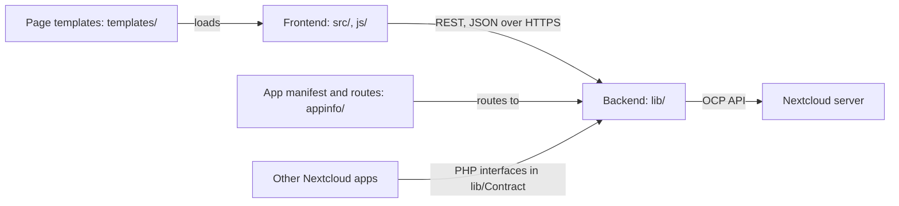

# Maintainability questionnaire

This page answers the high-level description questionnaire for a maintainability assessment of OpenRegister. Every question is quoted in the order of the questionnaire and followed by our answer. Where the documentation site covers the subject in more depth, a "See also" link points to that page.

Measurements are from 9 November 2026 (commit `30fbb6d5d676`) unless an answer says otherwise.

## General information

### 1. Date

> Date

9 November 2026.

### 2. Author

> Author

Conduction B.V. The names of the people who filled in the questionnaire are given on the submitted form.

### 3. Company and role

> Company and Role/ Job title

Conduction B.V., the developer and maintainer of OpenRegister.

### 4. System name

> System name

OpenRegister (Nextcloud app id `openregister`), https://github.com/ConductionNL/openregister

*Sources: `appinfo/info.xml`*

See also: [Introduction](https://openregister.conduction.nl/docs/intro/)

### 5. Version and snapshot date

> Version/ Snapshot date

The answers describe the code as of 9 November 2026, commit `30fbb6d5d676`, app version 2.1.35. Development happens on the `main` branch. The latest stable release is v2.1.0 (6 September 2026).

*Sources: `appinfo/info.xml` `<version>`; git tags*

### 6. In production since

> Date since in production/ to be released

The first tagged release is v0.1.2 (6 September 2024), published to the Nextcloud App Store. v1.0.0 followed on 8 May 2026 and v2.1.0 on 6 September 2026.

*Sources: git tags v0.1.2, v1.0.0, v2.1.0*

### 7. Lifecycle phase

> Lifecycle phase (pick best fitting)

Evolution. OpenRegister is in production and we still add functionality at a high rate: 11,009 commits landed between 9 August and 9 November 2026.

*Sources: git log since 2026-08-09; `openspec/changes/` (open change proposals)*

### 8. Business criticality

> Business criticality (pick best fitting)

High. OpenRegister is the data layer of the other Conduction apps, such as OpenCatalogi, Pipelinq and Dossiq. When it is down, those apps cannot read or write their data. An outage stays local to one organisation, because OpenRegister runs per Nextcloud instance and each organisation hosts its own.

*Sources: `ARCHITECTURE.md` (system boundary); `appinfo/info.xml` description*

See also: [OpenRegister feature overview](https://openregister.conduction.nl/docs/features/openregister-overview/)

## Technologies

### 9. Back end languages and frameworks

> Main programming languages & frameworks – Backend

PHP 8.3 or later on the Nextcloud App Framework (public `OCP` API), Nextcloud 32 to 35.

Main libraries: opis/json-schema 2.3 (object validation), webonyx/graphql-php 15, symfony/workflow 6.4, twig 3.27 (sandboxed templates), guzzlehttp/guzzle 7, web-token/jwt-library 4.1, phpseclib 3, phpoffice/phpspreadsheet 5, smalot/pdfparser 2.9, elasticsearch/elasticsearch 9.5, theodo-group/llphant 1.0, minishlink/web-push 11, react/async 4.

*Sources: `appinfo/info.xml` `<dependencies>`; `composer.json` require*

See also: [Service architecture](https://openregister.conduction.nl/docs/development/services-architecture/)

### 10. Front end languages and frameworks

> Main programming languages & frameworks – Frontend

Vue 3.5 with TypeScript 5.8 and JavaScript, Pinia 3, vue-router 5, @nextcloud/vue 9.13 and our shared library @conduction/nextcloud-vue 2.175. Built with webpack through @nextcloud/webpack-vue-config 7 and Babel 7.

*Sources: `package.json` dependencies and devDependencies*

See also: [Frontend architecture](https://openregister.conduction.nl/docs/development/frontend/)

### 11. Data storage

> Data storage technologies

OpenRegister has no database of its own. It uses the Nextcloud database through the Nextcloud QueryBuilder (Doctrine DBAL): PostgreSQL 10 or later (with pgvector for vector search), MySQL 8.0 or later, MariaDB, or SQLite. Files attached to objects live in Nextcloud file storage. Apache Solr 9 and Elasticsearch 8 or 9 are optional search back ends. Caching uses the Nextcloud memory cache (APCu or Redis).

*Sources: `appinfo/info.xml` `<database>`; `ARCHITECTURE.md`; `docker-compose.yml`*

See also: [Object storage and lifecycle](https://openregister.conduction.nl/docs/features/object-storage/)

### 12. Other technologies

> Other technologies (deployment, testing, etc.)

- Testing: PHPUnit 10.5, Jest 29 with @vue/test-utils, Playwright 1.64, Newman (Postman collections).
- Static analysis: PHP_CodeSniffer 3.9, PHPMD 2.15, Psalm 5, PHPStan 2, ESLint 10, Stylelint 17, Spectral (OpenAPI lint), REUSE (licensing).
- CI: GitHub Actions (`.github/workflows/code-quality.yml`, which reuses the shared ConductionNL/.github quality pipeline) plus the Hydra gates (`conduction/hydra-gates`).
- Release: GitHub Actions builds the app archive for the Nextcloud App Store, with a CycloneDX SBOM per release.
- Development environment: Docker Compose (Nextcloud, PostgreSQL, optional Solr, Elasticsearch, Ollama, n8n).
- Specifications: OpenSpec (Markdown) in `openspec/`. Documentation: Docusaurus in `docs/`.

*Sources: `composer.json` require-dev; `package.json` devDependencies; `.github/workflows/`; `SECURITY.md` (SBOM); `docker-compose.yml`*

See also: [Quality assurance](https://openregister.conduction.nl/docs/quality-assurance/)

## The system

### 13. What the system does

> Please describe the overall functionality of the system: What does the system do in terms of business functionality? What are some main functional scenarios?

OpenRegister stores structured data for Nextcloud. Administrators define data models as JSON Schema and group them in registers. Users and other apps then create, read, update and delete objects that are validated against those schemas.

Main functional scenarios:

- An administrator defines a register and its schemas, or imports them as a configuration package.
- A user creates and edits objects in the web interface, with files attached and relations to other objects.
- Another app, such as OpenCatalogi, Pipelinq or Dossiq, stores its data in OpenRegister instead of in tables of its own.
- An external system reads or writes objects through the REST API, GraphQL or MCP (for AI assistants).
- Users search across registers with full-text search, filters and facets.
- Every change is recorded in an audit trail. Retention rules archive or delete objects when their term ends.
- Changes fire events, webhooks and notifications, and can start flows and business rules.
- Text is extracted from attached files and can be vectorised for semantic search.

*Sources: `ARCHITECTURE.md`; `appinfo/info.xml` description; `docs/Features/`*

See also: [OpenRegister feature overview](https://openregister.conduction.nl/docs/features/openregister-overview/)

### 14. System boundary and actors

> Please describe or depict the boundaries of the system. A diagram/picture showing the system as a black box is highly appreciated: What are the actors/systems this system interacts with?

OpenRegister runs inside a Nextcloud server as an app. The diagram shows it as a black box with the actors and systems around it.

- End users and administrators use the web interface in a browser. Administrators also use `occ` console commands.
- Public visitors read data that a schema makes public, or open an access link.
- API clients call the REST API under `/apps/openregister/api`, GraphQL and the MCP endpoint.
- Other Conduction apps call OpenRegister in the same PHP process through its published contract (`lib/Contract/`), or through the REST API.
- Nextcloud core provides users, groups, the database, file storage, background jobs and notifications through the `OCP` API.
- Optional outbound services: Solr or Elasticsearch, LLM and text extraction services, webhook receivers, external data sources, GitHub or GitLab for configuration packages, OAuth2 providers.
- Federated Nextcloud instances exchange shares over Open Cloud Mesh.

*Sources: `ARCHITECTURE.md` (system boundary); `appinfo/routes.php`; `lib/Federation/`; `lib/Mcp/`*

See also: [Integrations](https://openregister.conduction.nl/docs/Integrations/)

### 15. History and team

> Please describe the history of the system. When did the development start? How many FTE/teams have been involved during the development in the past (a rough estimation is enough)? How many FTE/teams are currently maintaining it?

Development started in August 2024 (first commit 24 August 2024) at Conduction B.V. The repository holds about 19,000 commits.

- 2024: a team of about six Conduction developers, 464 commits.
- 2025: 3,366 commits by the same team, with one lead developer writing about two thirds of them.
- 2026: 15,235 commits up to 9 November, by a core team of three developers. Since 2026 most changes are written by AI coding agents (Claude Code) that developers direct and review. At least 48% of the commits since 9 August 2026 carry an explicit AI attribution.

*Sources: git log, authors per year (measured 9 November 2026); `Assisted-by` trailers since 2026-08-09: 5,290 of 11,009 commits*

## Scope for maintainability

### 16. Components and their connections

> What are the components of this system? In other words, if you are drawing a boxes-arrows diagram of the system: What are the boxes? What arrows/connections are expected between those boxes? What kind of arrows/connections are those (REST/API, code level dependencies like calls, inheritance, etc.)? Please provide such a diagram and fill in the following table with the list of all components along with a short description of their functionality together with the corresponding source code path(s).

A component is a top-level directory of the repository, as developers see it. `sigrid.yaml` declares it with `component_base_dirs: [""]`, and ADR-014 records the decision. Files in the repository root form one more component, "Root files".

| Name | Source code paths | What it does |
|---|---|---|
| Backend | `lib/` | All production PHP: controllers, services, data access, events, background jobs and the Nextcloud integration points. |
| Frontend | `src/` | Vue single-page app that runs in the browser. |
| App manifest and routes | `appinfo/` | App metadata (`info.xml`) and the route table (`routes.php`) that maps URLs to controllers. |
| Page templates | `templates/` | PHP templates that mount the frontend. |
| Static scripts | `js/` (3 hand-written scripts) | Web push client, its service worker and the flow operator. |
| Development containers | `docker/` | Entry points and seed scripts for the development and demo containers. Not shipped. |
| Root files | `webpack.config.js`, jest and playwright configs, `stylelint.config.js` | Build and test configuration. |

The components connect in three ways. The frontend calls the backend's controllers over REST with JSON, on the routes in `appinfo/routes.php`. Other Nextcloud apps call the backend in-process, through the PHP interfaces in `lib/Contract/`. The backend reaches the Nextcloud server through the public `OCP` API.

#### Inside the backend

The backend keeps the Nextcloud layout. ADR-013 sets the rules for its layers: a controller calls services, a service calls mappers, nothing calls back up a layer, and events replace upward calls. Architecture tests in `tests/Unit/Architecture/` check these rules. The table maps every directory under `lib/` to its role.

| Part | Source code paths | What it does |
|---|---|---|
| Controllers | `lib/Controller/` | HTTP API and page controllers. They check the caller's rights and hand over to services. |
| Middleware | `lib/Middleware/` | Request pipeline: rate limits, tenant quotas, CORS for public endpoints, request validation, audit of protected field reads. |
| Services (business logic) | `lib/Service/` | All capabilities: objects, schemas and registers, RBAC, configuration and import, flows and rules, retention, credentials. Holds 54% of the PHP code. |
| Data access | `lib/Db/` | Entities and mappers, including MagicMapper, which stores objects in one table per schema. |
| Search | `lib/Search/` | Search, facets, aggregations, GraphQL, Solr and Elasticsearch back ends, vectorisation. |
| Files | `lib/Files/` | File storage for objects, text extraction and chunking. |
| Notifications | `lib/Notifications/`, `lib/Notification/`, `lib/Push/`, `lib/Activity/` | Notifications, webhooks, web push and the Nextcloud activity stream. |
| MCP | `lib/Mcp/` | Model Context Protocol server and tool registry for AI assistants. |
| App host | `lib/AppHost/` | Runtime that serves manifest-driven apps built on OpenRegister. |
| Events and listeners | `lib/Event/`, `lib/Listener/` | Typed events fired on changes, and the listeners that react to them. |
| Background and console | `lib/BackgroundJob/`, `lib/Command/`, `lib/BulkAction/` | Cron jobs (extraction, retention sweeps, audit sealing), occ commands, bulk actions. |
| Install and upgrade | `lib/Migration/`, `lib/Repair/` | Database migrations (frozen once released) and repair steps. |
| Contracts and shared code | `lib/Contract/`, `lib/Kernel/`, `lib/Exception/`, `lib/Dto/`, `lib/Support/`, `lib/Formats/`, `lib/Twig/`, `lib/Lifecycle/` | Published interfaces for other apps (ADR-084), internal interfaces between parts, exceptions, value objects and helpers. |
| Nextcloud integration points | `lib/AppInfo/`, `lib/Calendar/`, `lib/Contacts/`, `lib/Dav/`, `lib/ContextChat/`, `lib/Federation/`, `lib/Reference/`, `lib/Dashboard/`, `lib/Sections/`, `lib/Settings/`, `lib/Capabilities/`, `lib/WorkflowEngine/` | Bootstrap and the providers Nextcloud loads: calendar, contacts, DAV, Context Chat, federation, link previews, dashboard widgets, settings pages, capabilities, workflow operations. `lib/Settings/` also holds shipped register definitions (JSON). |
| Shipped vocabularies | `lib/Resources/`, `lib/Service/Flow/Bpmn/schema/` | Third-party specifications shipped unchanged (schema.org, TOOI, MDTO, BPMN, GGM). See question 17. |

`ARCHITECTURE.md` also groups the backend by function (objects, schemas and registers, access control, retention and more). That grouping is an internal view, not a separate component split.

*Sources: `ARCHITECTURE.md`; `sigrid.yaml`; `openspec/architecture/adr-013-component-dependency-rules.md`; `openspec/architecture/adr-014-sig-components-are-top-level-directories.md`; hydra ADR-084 (OpenRegister published contract)*

See also: [Service architecture](https://openregister.conduction.nl/docs/development/services-architecture/)

### 17. Code outside the team's maintenance responsibility

> Which parts/directories/files of the system are not maintained by the development team or are not directly part of production code (test code, internal tooling, etc.)? Third-party libraries directly included as source code (like JavaScript libraries, etc.) without modification, Generated code? And if they are, or not touched/modified following generation? Migration, pre- and/or past- installation scripts, configuration files, etc.? Any other code part which is not in the (maintainability) responsibility of the development team?

Everything under `lib/`, `src/`, `appinfo/` and `templates/` is production code that we maintain, apart from the rows below. `sigrid.yaml` excludes the generated and tooling paths, and `ARCHITECTURE.md` gives the role of each directory.

| Path | Why it is out of scope |
|---|---|
| `lib/Migration/` | Database migrations. Production code, but each file is frozen once released. |
| `lib/Resources/`, `lib/Service/Flow/Bpmn/schema/` | Third-party vocabularies and specifications shipped unchanged (schema.org, TOOI, MDTO, BPMN, GGM). `REUSE.toml` names their owners. |
| `l10n/*.js` | Generated from `l10n/*.json`, the translation catalogues. No logic. |
| `js/` (except the three hand-written scripts) | Webpack build output. Ignored by git. |
| `vendor/`, `node_modules/`, `vendor-bin/` | Third-party packages installed by Composer and npm. Not in the repository; `vendor-bin/` only holds manifests for isolated tools. |
| `patches/` | Patches applied to third-party Composer packages at install time. |
| `scripts/`, `tools/`, scripts under `openspec/changes/` | Developer tooling: translation, quality, release and one-off change scripts. Not shipped. |
| `openspec/` | Specifications and change proposals (Markdown). |
| `docs/` | Documentation site (Docusaurus). |
| `docker/`, `docker-compose*.yml`, `openregister-compose.yaml`, `exapps/`, `n8n-templates/`, `n8n-mcp/`, `data/` | Local development and demo environments and example workflow templates. |
| `.github/`, `.claude/`, root configuration files (`eslint.config.mjs`, `phpstan-bootstrap.php`, `webpack.config.js`, jest and playwright configs) | CI configuration, AI developer tooling and build or analysis configuration. |
| `tests/` and `*.spec.js`, `*.spec.ts` under `src/` | Test code. See question 18. |

*Sources: `ARCHITECTURE.md` (directory roles); `sigrid.yaml` exclude; `REUSE.toml`*

### 18. Kinds of testing and where test code lives

> What kind of testing is performed (think about unit, integration, regression, end-to-end)? How can the test code be identified (where is it located)?

We run unit, integration, regression and end-to-end tests. All PHP test code lives in `tests/`. Front-end unit tests sit next to the code they test, with the suffix `.spec.js` or `.spec.ts`. Nothing under `lib/` or `src/` without that suffix is test code. CI runs the unit tests, Newman and Playwright on every pull request, so the full set doubles as the regression suite. The test code ratio is about 159% (test lines against production lines, measured 8 November 2026).

| Path | What it tests |
|---|---|
| `tests/Unit/` | PHPUnit unit tests, about 32,700 test methods. Runs in CI on every pull request. PHP statement coverage 79.64% (CI clover report, 8 November 2026). |
| `tests/Unit/Architecture/` | Architecture tests, for example that contracts stay leaves of the dependency graph. |
| `tests/Integration/`, `tests/integration/` | Integration tests against a running Nextcloud: PHPUnit, and Postman collections that CI runs with Newman (41 collections). |
| `tests/Service/`, `tests/Db/`, `tests/Api/`, `tests/Contract/` | Service, database, API and contract tests. |
| `tests/e2e/` | End-to-end tests with Playwright (144 spec files), run in CI against a Nextcloud instance. |
| `*.spec.js`, `*.spec.ts` under `src/` | Front-end unit tests with Jest and @vue/test-utils (370 spec files), next to the code they test. |
| `tests/Fixtures/`, `tests/fixtures/`, `tests/stubs/`, `tests/__mocks__/`, `tests/Data/` | Test data, stubs and mocks. |
| `tests/perf/`, `tests/performance/`, `tests/manual/`, scripts at the root of `tests/` | Performance and manual test scripts, run by hand. |

*Sources: `ARCHITECTURE.md` (test code); `phpunit.xml`; `package.json` scripts; `.github/workflows/code-quality.yml`*

See also: [Testing](https://openregister.conduction.nl/docs/testing/)

## Other remarks

### 19. Additional remarks

> Please use the space below for any additional remarks

- `ARCHITECTURE.md` in the repository root is written for assessors. It names the components, their boundaries and the role of each directory.
- `sigrid.yaml` pins the maintainability model to 2026, declares the components and excludes generated files and tooling.
- OpenRegister is large: about 392,000 lines of PHP outside migrations and about 115,000 lines of front-end code. We are reducing coupling between components and splitting long parameter lists, guided by a set of architecture decisions.
- Most of the code since 2026 was written by AI coding agents under developer direction. Every change goes through the same CI gates as code written by hand.

*Sources: `ARCHITECTURE.md`; `sigrid.yaml`*

### 20. Time spent and feedback

> How much time was spent filling in this form? Other feedback?

Given on the submitted form.

## Related

See also [the security questionnaire](./security.md) and [ARCHITECTURE.md](https://github.com/ConductionNL/openregister/blob/main/ARCHITECTURE.md).
